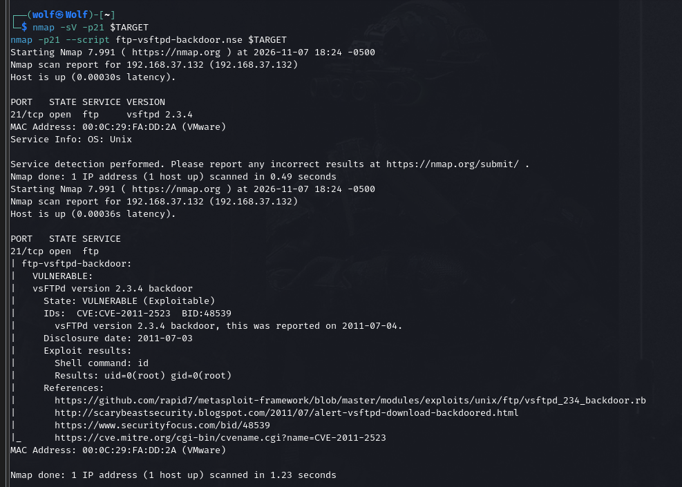
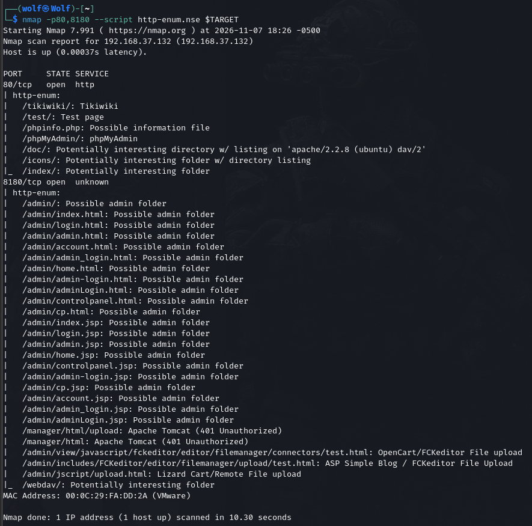
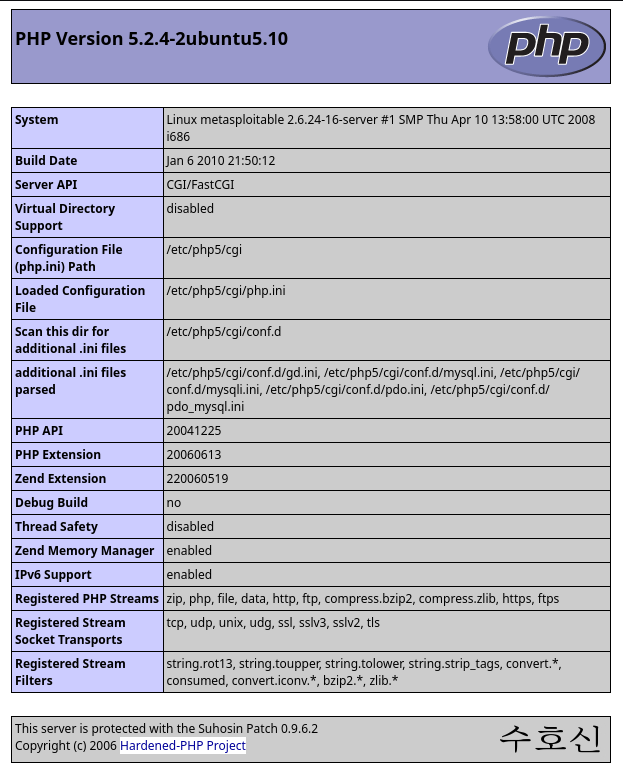
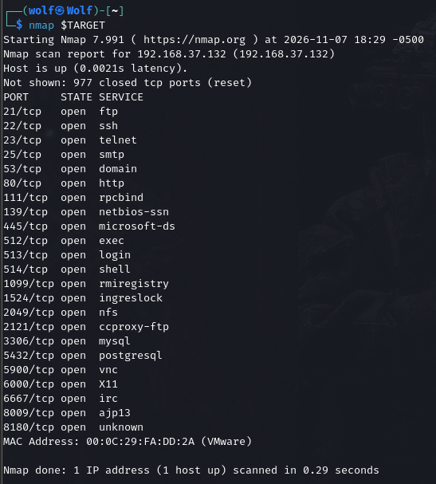
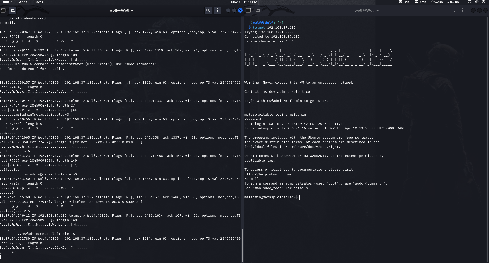
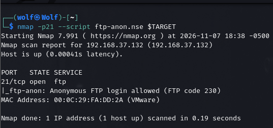

# S06 — Network, Port and Vulnerability Scanning (Metasploitable 2)

**Author:** Raja Wardet Wahaj (Wolf)
**Program:** DFCS Bootcamp, Atomcamp (Cohort 2)
**Tasks completed:** Task A (three findings), B3, B4

Full report: [DFCS_Day2_HomeWork_Raja_Wardet_Wahaj.pdf](DFCS_Day2_HomeWork_Raja_Wardet_Wahaj.pdf)

## Lab Environment

| Machine | Address | Role |
|---|---|---|
| Kali Linux | 192.168.50.x | Assessment machine |
| Metasploitable 2 | 192.168.37.132 | Intentionally vulnerable target |

All testing was done in an isolated NAT lab against a deliberately vulnerable machine.

## Tools Used

Kali Linux, Nmap (`-sV`, NSE: `ftp-vsftpd-backdoor`, `http-enum`, `ftp-anon`), tcpdump, telnet.

---

## Task A — Findings

| # | Finding | Asset | Identifiers | CVSS v3.1 | Severity |
|---|---|---|---|:---:|---|
| 1 | FTP backdoor command execution in vsftpd 2.3.4 | 21/tcp | CVE-2011-2523, CWE-78 | 9.8 | Critical |
| 2 | Exposed phpinfo.php (information disclosure) | 80/tcp, Apache 2.2.8 | CWE-200 | 5.3 | Medium |
| 3 | Telnet service exposed (cleartext protocol) | 23/tcp | CWE-319 | 5.9 | Medium |

### Finding 1 — vsftpd 2.3.4 backdoor

The vsftpd 2.3.4 archive distributed between 30 June and 3 July 2011 contained a backdoor. A username with a specific character sequence opens a shell listener on 6200/tcp. It was a supply-chain compromise, not a coding error.

```bash
nmap -sV -p21 192.168.37.132
nmap -p21 --script ftp-vsftpd-backdoor.nse 192.168.37.132
```

The script reports `VULNERABLE` and returns `uid=0(root) gid=0(root)` from its test command.




**Remediation:** upgrade from a trusted distribution repository, verify signatures, and treat the host as compromised.

### Finding 2 — Exposed phpinfo.php

A diagnostic page printing PHP version, modules, configuration and paths is reachable without authentication.

```bash
nmap -p80,8180 --script http-enum.nse 192.168.37.132
```




**Remediation:** delete phpinfo.php from the web root, restrict diagnostic pages, and review the web root for other leftovers.

### Finding 3 — Telnet exposed

Telnet sends usernames, passwords and the whole session in cleartext, which is a design weakness of the protocol.

```bash
nmap 192.168.37.132
sudo tcpdump -i eth0 -A port 23
telnet 192.168.37.132
```




**Remediation:** disable telnet, use SSH (22/tcp), and block 23/tcp at the firewall.

---

## Task B3 — CVSS Vector for CVE-2011-2523

`CVSS:3.1/AV:N/AC:L/PR:N/UI:N/S:U/C:H/I:H/A:H` = **9.8 Critical**

| Metric | Value | Plain English |
|---|---|---|
| Attack Vector | Network | Attacker can be anywhere that can reach the port |
| Attack Complexity | Low | No special conditions; works every time |
| Privileges Required | None | No account needed |
| User Interaction | None | No employee has to click or approve anything |
| Scope | Unchanged | Damage stays inside the vulnerable component |
| Confidentiality | High | Everything the account can read is exposed |
| Integrity | High | Everything it can write can be altered |
| Availability | High | Service or host can be taken offline |

*Manager summary: an anonymous attacker anywhere on the network can take full control of this server with one connection, no password and no help from any employee.*

---

## Task B4 — CWE Classification

| # | Vulnerability | CWE | Reasoning |
|---|---|---|---|
| 1 | vsftpd 2.3.4 backdoor (CVE-2011-2523) | CWE-78 OS Command Injection | Input (the triggering username) reaches a system shell |
| 2 | Anonymous FTP login allowed | CWE-306 Missing Authentication for Critical Function | Service grants file access with no identity check |
| 3 | Telnet in use (port 23) | CWE-319 Cleartext Transmission | Credentials cross the network unencrypted |



### How remediation differs by class

- **CWE-78:** replacing one binary is not enough. Reinstall from a trusted source, verify signatures, treat the host as compromised.
- **CWE-306:** a configuration change. Disable anonymous access or require credentials, then re-test with `ftp-anon`.
- **CWE-319:** a design replacement. Retire the protocol and move to SSH. Patching cannot fix it.

Each class needs a different owner and a different fix, which is why the report carries the CWE and not only the CVE.

---

## References

1. Debian Security Tracker, CVE-2011-2523 — https://security-tracker.debian.org/tracker/CVE-2011-2523
2. MITRE, CWE-78 — https://cwe.mitre.org/data/definitions/78.html
3. Openwall oss-security, vsftpd-2.3.4 backdoor disclosure (2011) — https://www.openwall.com/lists/oss-security/2011/07/04/4
4. MITRE, CWE-200 — https://cwe.mitre.org/data/definitions/200.html
5. MITRE, CWE-319 — https://cwe.mitre.org/data/definitions/319.html
6. MITRE, CWE-306 — https://cwe.mitre.org/data/definitions/306.html
7. NIST NVD, CVE-2011-2523 — https://nvd.nist.gov/vuln/detail/CVE-2011-2523
